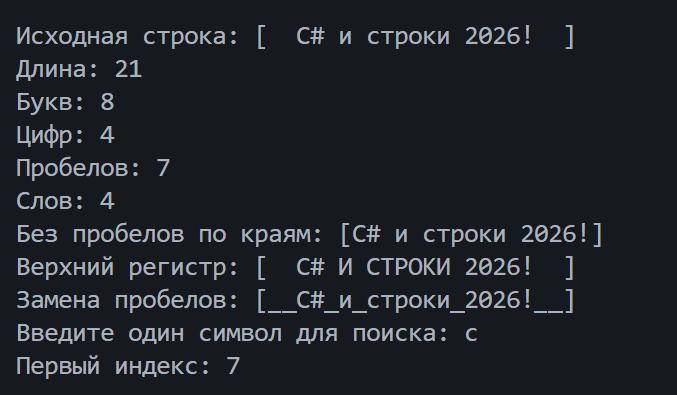

# Практическая работа №19

Автор: Милад Бакулин  
Группа: ИСП-251

## Тема

Строки в C#.

## Что реализовано

- определение длины строки;
- подсчёт букв, цифр, пробелов и слов;
- поиск первого индекса символа;
- удаление пробелов по краям;
- перевод в верхний регистр;
- замена пробелов на подчёркивания.
- Самостоятельное задание: <выбрать одно — последний индекс / количество гласных / слова без Split()>.

## Короткие ответы

1. Чем отличаются `string` и `char`?

Ответ: string — это строка , а char — один символ.

2. Почему вызов `text.Trim()` без сохранения результата не меняет `text`?

Ответ: строки в C# неизменяемы. 

3. Зачем при разделении строки используется `RemoveEmptyEntries`?

Ответ: при обычном `Split` несколько пробелов подряд дают пустые строки в массиве. `RemoveEmptyEntries` их вырезает и массив заполняется исключительно символами

## Результат

